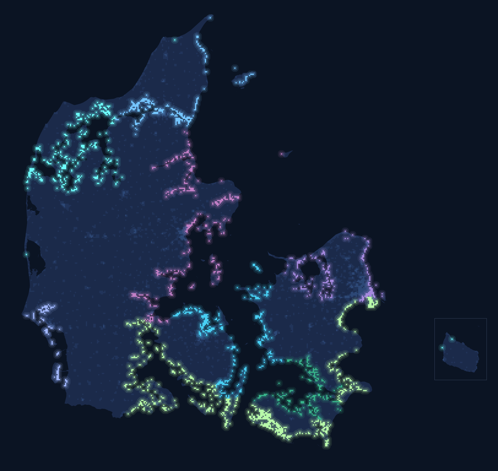

<!-- Ported from the standalone CAD site (github.com/soerendamsbo/cad). Styles in cad.css. -->

```{=html}
<div class="cad-hero column-screen">
  <div class="cad-hero-inner">
    <div>
      <p class="cad-kicker">Research project &middot; 2026&ndash;2028</p>
      <h1>Climate Adaptation of Democracy</h1>
      <p class="cad-sub">Climate impacts on environmental and democratic attitudes</p>
    </div>
    
  </div>
</div>
```

**Climate Adaptation of Democracy (CAD)** studies how adverse climate events affect democracy. The project asks: *How do adverse local climate events affect citizens' attitudes towards democracy and the green transition, and what strategies for communication can help create effects that are environmentally and democratically sustainable?*

CAD is based at the Department of Political Science, University of Copenhagen, and funded by the Independent Research Fund Denmark (DFF). It is led by Kasper M. Hansen (professor) with Søren Damsbo-Svendsen (postdoc), both at the University of Copenhagen, and Morten A. Dahl Larsen (senior researcher) from the Danish Meteorological Institute (DMI).

::: {.cad-status}
October\ 2026 · **Survey ready to field** · waiting for the next storm surge
:::

```{=html}
<figure class="frame-map">
  <div class="fm-stat">
    <span class="fm-n">2,576</span>
    one-kilometre squares with homes inside Denmark's storm-surge risk area
  </div>
  <button type="button" class="fm-zoom-btn" aria-label="Zoom into the map"><i class="bi bi-zoom-in" aria-hidden="true"></i> Zoom</button>
  
  <figcaption>
    <div class="fm-kicker">The coast we are watching</div>
    <p>Each lit square is one square kilometre of coast with homes inside the storm-surge risk area. Together they trace the Wadden Sea, the fjords, the southern islands and Øresund.</p>
    <p class="fm-source">Data: DMI storm-surge risk maps · Danish address and building registers · DAGI. Bornholm moved closer.</p>
  </figcaption>
</figure>
```

```{=html}
<div class="map-viewer" role="dialog" aria-modal="true" aria-label="Zoomable map of the storm-surge coast" hidden>
  <div class="mv-stage"></div>
  <div class="mv-controls">
    <button type="button" data-mv="in" aria-label="Zoom in"><i class="bi bi-plus-lg" aria-hidden="true"></i></button>
    <button type="button" data-mv="out" aria-label="Zoom out"><i class="bi bi-dash-lg" aria-hidden="true"></i></button>
    <button type="button" data-mv="reset" aria-label="Reset zoom"><i class="bi bi-arrows-angle-contract" aria-hidden="true"></i></button>
    <button type="button" data-mv="close" aria-label="Close"><i class="bi bi-x-lg" aria-hidden="true"></i></button>
  </div>
  <p class="mv-hint"><span class="mv-hint-mouse">Scroll to zoom &middot; drag to move &middot; Esc to close</span><span class="mv-hint-touch">Pinch to zoom &middot; drag to move</span></p>
</div>
<script src="panzoom.min.js"></script>
<script>
// Map viewer: the full-resolution map (media/map-frame-zoom.webp, 6000 px) loads on
// first open; the inline image stands in until it arrives. Panzoom 4.6.2, vendored.
(() => {
  const viewer = document.querySelector(".map-viewer");
  const stage = viewer.querySelector(".mv-stage");
  const img = viewer.querySelector(".mv-img");
  let pz = null, opener = null;

  const open = (e) => {
    opener = e.currentTarget;
    if (!img.src) {
      img.src = "media/map-frame.png";
      const hi = new Image();
      hi.onload = () => { img.src = hi.src; };
      hi.src = "media/map-frame-zoom.webp";
    }
    viewer.hidden = false;
    document.body.style.overflow = "hidden";
    if (!pz) {
      pz = Panzoom(img, { maxScale: 12, contain: "outside", overflow: "visible", step: 0.5 });
      stage.addEventListener("wheel", pz.zoomWithWheel);
      img.addEventListener("dblclick", (ev) => pz.zoomToPoint(Math.min(pz.getScale() * 2, 12), ev));
    }
    viewer.querySelector('[data-mv="close"]').focus();
  };
  const close = () => {
    viewer.hidden = true;
    document.body.style.overflow = "";
    pz.reset({ animate: false });
    if (opener) opener.focus();
  };

  document.querySelectorAll(".fm-zoom-btn, .fm-zoomable").forEach((el) => el.addEventListener("click", open));
  viewer.querySelector(".mv-controls").addEventListener("click", (e) => {
    const b = e.target.closest("button");
    if (!b) return;
    ({ in: () => pz.zoomIn(), out: () => pz.zoomOut(), reset: () => pz.reset(), close })[b.dataset.mv]();
  });
  document.addEventListener("keydown", (e) => { if (e.key === "Escape" && !viewer.hidden) close(); });
})();
</script>
```

## Waiting for the storm

Twelve times between 2011 and 2023, the Danish authorities officially declared a storm surge: sea water over the coast, and often into people's homes. When the next one comes, our survey can reach residents of the hit coastline within about a month, while the experience is still fresh, and ask about their views on climate action and on democracy.

Most of what we know about disasters and public opinion comes from surveys that happened to be in the field, or from asking people long afterwards. We built the study first, and now we wait for the next surge.

## What we have prepared

Getting a survey into the field within weeks of a disaster took a lot of groundwork:

::: {.cad-steps}
- We reconstructed every official storm-surge declaration from 2011 to 2023, so we know where and how the declarations come.
- We mapped every one-kilometre square of Danish coast with homes inside the storm-surge risk area. Together, these squares hold more than 500,000 homes.
- Within days of a surge, we model the flooding with DMI to find which homes the water reached.
- With Denmark's national registers and the survey agency Epinion, we can turn a list of coastal addresses into survey invitations in people's Digital Post within weeks.
:::

## What's next

::: {.cad-next}
::: {.cad-next-item}
**More storms.** We can reuse the design. Each surge we survey adds a new case, and with enough cases we can study how communities respond to repeated flooding.
:::
::: {.cad-next-item}
**Experiments.** Survey experiments on how to talk about climate risk and adaptation in ways that sustain both climate action and trust in democracy.
:::
::: {.cad-next-item}
**A national picture.** A nationwide survey on the same questions: what Danes expect of their democracy when climate events hit close to home.
:::
:::

::: {.cad-partners}
{fig-alt="University of Copenhagen"}

{fig-alt="Independent Research Fund Denmark"}

{fig-alt="Danish Meteorological Institute"}
:::
