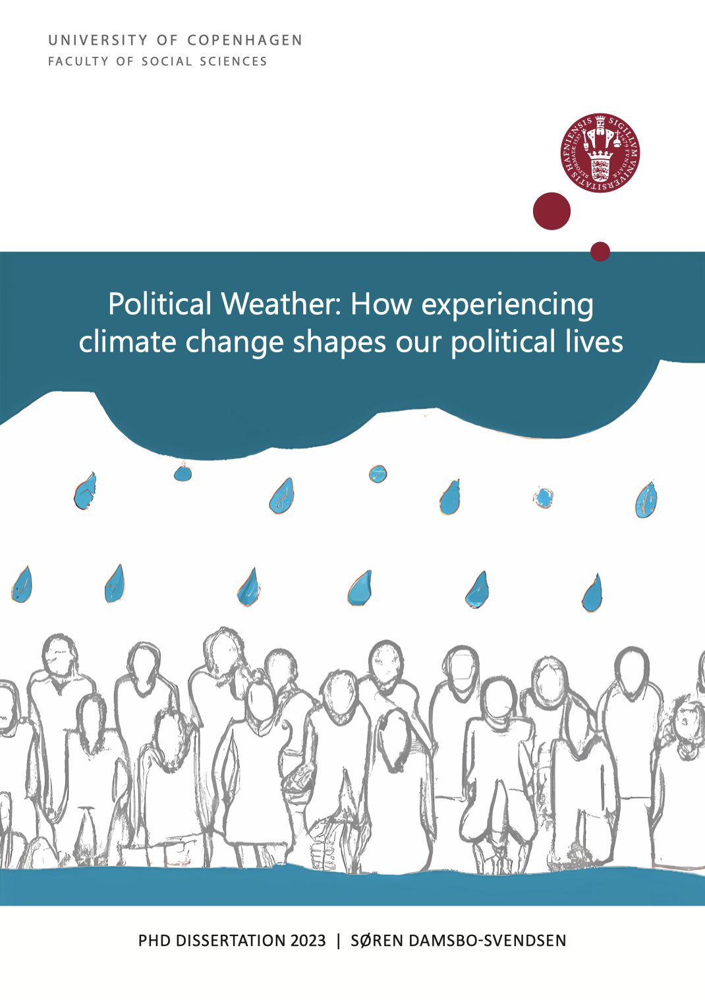

```{=html}
<div class="phd-hero">
  
  <div>
    <dl class="phd-facts">
      <dt>Submitted</dt><dd>5 September 2023</dd>
      <dt>Defended</dt><dd>9 January 2024</dd>
      <dt>Institution</dt><dd>Department of Political Science, University of Copenhagen</dd>
      <dt>Supervisors</dt><dd>Kasper M. Hansen &amp; Frederik Hjorth</dd>
    </dl>
    <div class="pub-actions">
      <a class="pub-btn" href="https://web.tresorit.com/l/Hk1AI#iJCuKFJev4lXCJejdiUzbA">Download thesis &#8599;</a>
      <span class="phd-pw">password: <code>poliweather</code></span>
    </div>
    <div class="pub-actions">
      <a class="pub-btn" href="https://soerendamsbo.github.io/misc-slides/phd-defense_updated.html">Defence slides &#8599;</a>
      <span class="phd-pw">updated since the defence &middot; <a href="https://soerendamsbo.github.io/misc-slides/phd-defense.html">original version</a></span>
    </div>
  </div>
</div>
```

## The four papers

::: {#phd-articles}
:::

## Abstract

Global climate change is an increasingly large part of our lives and will remain so in the future. How will it affect us as political beings? This PhD dissertation investigates how citizens' personal experience with weather and climate shapes political opinions, beliefs, and behavior toward climate change. Public support for the green transition is pivotal, and lack of public support can be an important barrier to climate action and adaptation. Because climate change is abstract, complex, and relatively new as a major political issue, political elites and the media could be driving public climate opinion. However, it is possible for voters to circumvent elite discourse and, instead, experience climate change directly in extreme and unusual weather events that are exacerbated by global warming. The changing weather, thus, has political causes, but what are the political consequences? Weather experiences provide unmediated information about climate change, but is personal experience translated into pro-climate opinions and behavior? Yes, it is, as the dissertation demonstrates.

The dissertation's overall research question is: *How are voters' climate opinions and behavior shaped by media coverage of climate change and personal weather experiences?* The key findings show that personal experience with more extreme weather, including high temperatures and local flooding, and increased media coverage of climate change raise climate concern and cause a shift toward more pro-climate beliefs, opinions, and behavior. As climate change is experienced more, now and in the future, this can foster public support for the creation of a more sustainable society. This is crucial knowledge because it shows that climate change, as it worsens, helps creating the conditions for a green transition. In that sense, the dissertation is relatively optimistic about the nature of the public's response to climate change. It contributes with knowledge about how individuals translate their own personal experiences into political opinions and behavior, which is crucial to find viable political solutions to climate change.

The dissertation consists of a project frame, which sets the research questions up against existing theory and knowledge gaps, and four self-containing research articles: Article 1: Media, Article 2: Temperature, and Article 4: Turnout are published in *International Journal of Public Opinion Research*, *West European Politics*, and *Electoral Studies*, respectively, and Article 3: Flooding is under review at *American Political Science Review* [since published in *Political Behavior* (2025)]. The four articles creatively combine large datasets and apply research designs that facilitate causal inference about the effects of personal experience on climate opinions and behavior. Denmark is the dissertation's core research case. It is a comparatively well-functioning political system with low levels of political polarization, high political participation and trust, high consumption of non-partisan public service news, and high degrees of consensus about the reality and fundamental seriousness of climate change. Studying voters' responses to climate change in a country like Denmark is ostensibly a conservative test of weather effects because of comparatively strong preexisting pro-climate opinions and a mild climate, which makes weather experiences less forceful than in other regions. Thus, the positive effects of weather and media coverage demonstrated in Denmark likely also apply to contexts with less attitude ceiling effects and stronger weather experiences. Meanwhile, widespread climate literacy and low levels of political polarization among voters, media, and political elites, may be the key to constructive public responses to climate change, as people see and feel the climate more in their everyday lives and local communities.

<details class="phd-abstract-da" lang="da">
<summary>Dansk resumé</summary>

Globale klimaforandringer er i stigende grad en del af vores liv og vil fortsætte med at være det i fremtiden. Denne ph.d.-afhandling undersøger, hvordan borgernes personlige erfaringer med vejr og klima påvirker politiske holdninger, opfattelser og adfærd relateret til klimaforandringer. Folkelig opbakning til den grønne omstilling er afgørende, og manglende opbakning kan være en væsentlig barriere for klimahandling og klimatilpasning. Fordi klimaforandringer er abstrakte, komplekse og et relativt nyt politisk emne, er det muligt, at den offentlige mening drives af politiske eliter og medier. Dog kan vælgerne også omgå elitediskurser og, i stedet, opleve klimaforandringer direkte igennem ekstreme og usædvanlige vejrbegivenheder, der forstærkes og forværres af global opvarmning. Forandringer i vejret har dermed politiske årsager, men hvad er de politiske konsekvenser? Vejroplevelser formidler umedieret information om klimaet, men omdannes personlige erfaringer også til klimavenlige holdninger og adfærd? Ja, de gør, ifølge denne afhandling.

Afhandlingens overordnede forskningsspørgsmål er: *Hvordan påvirkes vælgernes klimaholdninger og adfærd af mediers klimadækning og personlige vejroplevelser?* Hovedresultaterne viser, at personlige oplevelser med mere ekstremt vejr, inklusive høje temperaturer og lokale oversvømmelser, samt øget medieomtale af klimaforandringer skaber øget klimabekymring og medfører et skift i retning af mere klimavenlige opfattelser, holdninger og adfærd. Efterhånden som klimaforandringerne opleves mere, nu og i fremtiden, kan dette fostre folkelig opbakning til skabelsen af et mere bæredygtigt samfund. Dette er vigtig viden, fordi det viser, at efterhånden som klimaforandringerne forværres, bidrager de til at skabe forudsætningerne for den grønne omstilling. I den forstand er afhandlingen relativt optimistisk, hvad angår borgernes reaktioner på klimaforandringer. Den bidrager med viden om, hvordan individer oversætter deres egen personlige erfaringer til politiske holdninger og adfærd, hvilket er afgørende for at finde reelle politiske løsninger på klimaudfordringen.

Afhandlingen består af en projektramme, som sætter forskningsspørgsmålene op imod eksisterende teori og videnshuller, samt fire selvstændige forskningsartikler: Artikel 1: Medier, Artikel 2: Temperatur, og Artikel 4: Valgdeltagelse er udgivet i henholdsvis *International Journal of Public Opinion Research*, *West European Politics*, og *Electoral Studies*, mens Artikel 3: Oversvømmelse er under fagfællebedømmelse i *American Political Science Review* [siden udgivet i *Political Behavior* (2025)]. De fire forskningsartikler kombinerer på kreativ vis store datasæt og anvender forskningsdesigns, der faciliterer kausal inferens om effekterne af personlige erfaringer på klimaholdninger og adfærd. Danmark er afhandlingens centrale *case*. Det er et relativt velfungerende politisk system med en lav grad af politisk polarisering, høj politisk deltagelse og tillid, højt forbrug af upartiske public service-nyheder, og udbredt konsensus om virkeligheden og alvorligheden af klimaforandringer. At undersøge vælgernes reaktioner på klimaforandringer i et land som Danmark er umiddelbart en konservativ test af vejreffekter på grund af relativt klimavenlige holdninger og et mildt klima, som gør vejroplevelser mindre kraftfulde end andre steder. Derfor gør de positive effekter af vejr og mediedækning, som jeg demonstrerer i Danmark, sig sandsynligvis også gældende i kontekster med mindre holdningsloftseffekter og stærkere vejroplevelser. Samtidigt er det muligt, at udbredt klimaforståelse og begrænset politisk polarisering blandt vælgere, medier og politiske eliter er nøglen til borgernes konstruktive reaktion på klimaforandringer, efterhånden som borgerne ser og føler klimaet mere i deres hverdag og lokalsamfund.

</details>
